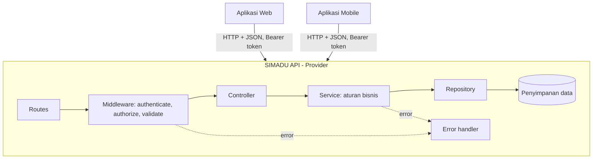

# Analisis Kebutuhan dan Rancangan REST API SIMADU (Soal 1)

## 1. Aktor

| Aktor         | Peran                                                                                      |
| ------------- | ------------------------------------------------------------------------------------------ |
| Mahasiswa     | Membuat pengaduan, melihat dan mengubah/menghapus pengaduannya sendiri selama `diajukan`   |
| Administrator | Melihat seluruh pengaduan dan memperbarui status penanganan; tidak membuat/mengubah isi    |
| Consumer      | Aplikasi web dan aplikasi mobile yang memanggil API atas nama aktor di atas                |

## 2. Resource utama

| Resource    | Keterangan                                                      | Path dasar        |
| ----------- | --------------------------------------------------------------- | ----------------- |
| `auth`      | Proses login yang menghasilkan token (bukan resource tersimpan) | `/api/auth`       |
| `pengaduan` | Pengaduan mahasiswa (resource utama)                            | `/api/pengaduan`  |
| `status`    | Sub-resource status penanganan pengaduan                        | `/api/pengaduan/:id/status` |

Pengguna (mahasiswa/admin) ada di sisi server sebagai data akun, tetapi tidak dibuka sebagai resource API pada UTS ini.

## 3. Tabel kontrak endpoint

| Metode | Endpoint                    | Role                              | Request body                                 | Respons sukses            | Respons gagal                        |
| ------ | --------------------------- | --------------------------------- | -------------------------------------------- | ------------------------- | ------------------------------------ |
| POST   | `/api/auth/login`           | publik                            | `{username, password}`                       | 200 `{token, tokenType, expiresAt, user}` | 400 validasi, 401 kredensial salah |
| GET    | `/api/pengaduan`            | mahasiswa / admin                 | —                                            | 200 daftar pengaduan sesuai hak akses | 401 |
| GET    | `/api/pengaduan/:id`        | mahasiswa (pemilik) / admin       | —                                            | 200 satu pengaduan        | 400 ID salah, 401, 403 bukan pemilik, 404 |
| POST   | `/api/pengaduan`            | mahasiswa                         | `{judul, kategori, deskripsi}`               | 201 pengaduan baru        | 400 validasi, 401, 403 (admin)       |
| PUT    | `/api/pengaduan/:id`        | mahasiswa pemilik, status `diajukan` | `{judul, kategori, deskripsi}`            | 200 pengaduan terbaru     | 400, 401, 403 (bukan pemilik / bukan `diajukan` / admin), 404 |
| PATCH  | `/api/pengaduan/:id/status` | admin                             | `{status}` (`diajukan`/`diproses`/`selesai`) | 200 pengaduan terbaru     | 400, 401, 403 (mahasiswa), 404       |
| DELETE | `/api/pengaduan/:id`        | mahasiswa pemilik, status `diajukan` | —                                         | 200 `data: null`          | 400, 401, 403, 404                   |

Semua kegagalan tak terduga: **500** dengan pesan generik.

## 4. Struktur JSON

Pengaduan:

```json
{
  "id": 1,
  "mahasiswaId": "240104040001",
  "judul": "AC ruang kelas B2 tidak dingin",
  "kategori": "Fasilitas",
  "deskripsi": "AC di ruang B2 mati sejak minggu lalu.",
  "status": "diajukan",
  "createdAt": "2026-11-02T08:15:00.000Z"
}
```

Pembungkus respons berhasil:

```json
{ "success": true, "message": "Pengaduan berhasil dibuat", "data": { } }
```

Pembungkus respons gagal:

```json
{ "success": false, "message": "Validasi gagal", "errors": [ { "field": "judul", "message": "Field tidak boleh kosong" } ] }
```

## 5. Status HTTP

| Kode | Dipakai ketika                                                                                  |
| ---- | ----------------------------------------------------------------------------------------------- |
| 200  | Permintaan baca/ubah/hapus/login berhasil                                                        |
| 201  | Pengaduan berhasil dibuat                                                                        |
| 400  | Input tidak valid (field wajib kosong, tipe salah, field tak dikenal, JSON rusak, ID bukan angka) |
| 401  | Tidak terautentikasi: token tidak ada / tidak valid / kedaluwarsa, atau login salah              |
| 403  | Terautentikasi tetapi tidak berhak: role salah, bukan pemilik, status bukan `diajukan`           |
| 404  | Pengaduan atau endpoint tidak ditemukan                                                          |
| 500  | Kesalahan server tak terduga (tanpa detail internal)                                             |

## 6. Alur komunikasi dan pembagian komponen

### Diagram arsitektur (consumer–provider)

```
 +----------------+      +----------------+
 |  Aplikasi Web  |      | Aplikasi Mobile|        CONSUMER
 +--------+-------+      +--------+-------+
          \                       /
           \  HTTP + JSON        /
            \  (Bearer token)   /
             v                 v
   +-------------------------------------------+
   |            SIMADU API (PROVIDER)          |
   |                                           |
   |  Routes                                   |
   |     |                                     |
   |     v                                     |
   |  Middleware: logger -> authenticate (401) |
   |     -> authorize role (403) -> validate (400)
   |     |                                     |
   |     v                                     |
   |  Controller  (HTTP <-> service)           |
   |     |                                     |
   |     v                                     |
   |  Service  (aturan bisnis: pemilik, status)|
   |     |                                     |
   |     v                                     |
   |  Repository (akses data)                  |
   |     |                                     |
   |     v                                     |
   |  Penyimpanan (array memori)               |
   |                                           |
   |  Error handler terpusat (400/401/403/404/500)
   +-------------------------------------------+
```

Diagram yang sama dalam bentuk Mermaid (bisa dirender di GitHub / Mermaid Live):



### Alur login lalu akses data

```
Consumer                                  Provider (SIMADU API)
   |  POST /api/auth/login {username,pwd}        |
   |-------------------------------------------->|  validasi -> cek hash bcrypt
   |  200 {token, expiresAt, user}               |  -> terbitkan JWT (sub, role, exp)
   |<--------------------------------------------|
   |  GET /api/pengaduan  Authorization: Bearer  |
   |-------------------------------------------->|  cek token (401?) -> cek role (403?)
   |                                             |  -> service: filter sesuai hak akses
   |  200 {data:[...]}                           |
   |<--------------------------------------------|
```

### Pembagian komponen

| Komponen    | Tugas                                                                      |
| ----------- | -------------------------------------------------------------------------- |
| Router      | Memetakan URL ke rantai middleware dan controller                          |
| Middleware  | Autentikasi (401), otorisasi role (403), validasi input (400), logging, error handler |
| Controller  | Menerjemahkan request HTTP ke pemanggilan service dan menyusun respons     |
| Service     | Aturan bisnis: kepemilikan, kebijakan status `diajukan`, login, penerbitan token |
| Repository  | Baca/tulis data pengaduan dan akun                                         |
